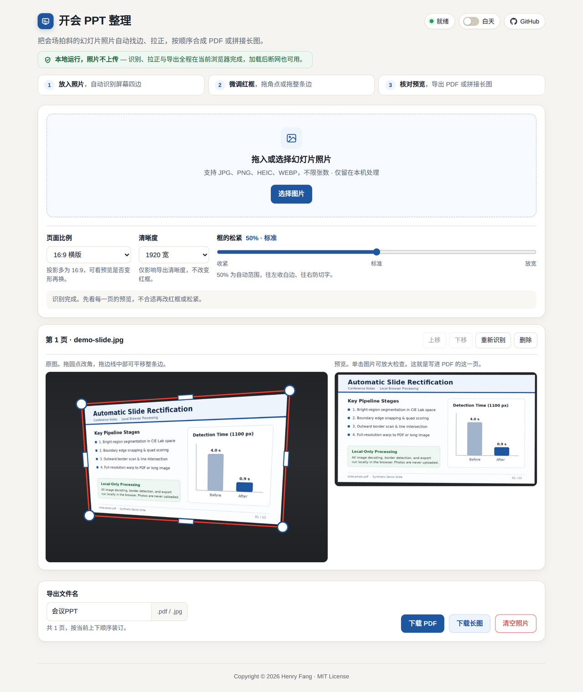

**English** | [简体中文](README.zh-CN.md)

# slide-photo-pdf

Automatically detect, rectify, and export angled conference slide photos into a clean **PDF** or a **vertically stitched long image** — running **100% locally in your browser**.

> **Live Demo:** [https://ideafang.github.io/slide-photo-pdf/](https://ideafang.github.io/slide-photo-pdf/)
>
> **Privacy:** Photos never leave your device. Decoding, border detection, perspective rectification, and PDF/image export all run locally in the browser. Once the page and libraries finish loading, it continues to work offline.



## Why this exists

Conference slide photos taken from the audience are usually skewed, and a speaker or podium often blocks one corner. Open the page, drop in your photos, check or fine-tune the red quadrilateral if needed, and export one clean PDF or a stitched long JPEG in seconds.

## Features

- **100% client-side**: Built with OpenCV.js and libheif-js. No backend, no account, no file upload.
- **Broad format support**: Supports JPEG, PNG, WEBP, BMP, and HEIC with no hard page-count limit (actual capacity depends on device memory).
- **Interactive corner & edge editing**: Drag individual corner dots, or drag edge midpoints to shift an entire side while a magnifier follows your pointer.
- **Batch framing & output controls**: Adjust box tightness globally (±6% around auto-detection), choose aspect ratio (`16:9`, `4:3`, `16:10`, `3:2`, or detected edge lengths), and select export width (`1280`, `1920`, or `2560`).
- **Flexible export**: Download a single **PDF** or a **vertically stitched long JPEG** (with automatic canvas-size safety scaling on mobile), customize the filename (`会议PPT` by default), reverse page order for newest-first phone albums, or clear all photos for the next batch.
- **Day & night themes + status light**: Toggle between day and night mode at the top right; the status lamp indicates loading (red), reading (blue), computing (purple), and ready (green).

## Run locally

Use the hosted GitHub Pages demo above, or serve this repository locally over HTTP (browsers block WASM/library loading if `index.html` is opened directly as a `file://` URL).

Python 3 is enough — no extra packages needed:

```bash
./serve.sh
```

Then open http://127.0.0.1:8766/ .

```bash
HOST=127.0.0.1 PORT=8766 ./serve.sh
```

- `127.0.0.1` accepts connections only from the local machine (default).
- `0.0.0.0` or a LAN IP such as `192.168.1.20` lets phones or other devices open the page; only static web assets are served, while photos stay on each visiting device.

The first visit fetches OpenCV.js and the HEIC decoder (~15 MB). The page tries jsDelivr first and falls back to the copies in `vendor/` if that CDN is unreachable. After the libraries have loaded, later work on that visit does not need the network.

## How a slide is detected

1. The photo is downscaled to ~1100 px on the long side and segmented across multiple CIE Lab luminance thresholds to find candidate bright regions.
2. Each region produces candidate quadrilaterals via convex-hull extremes, boundary Canny/Hough snapping, and long-edge clustering.
3. Deduplicated candidates are warped to a temporary grayscale `16:9` frame and scored by border roughness, internal line alignment, and area.
4. Each edge of the winning box is calibrated by scanning outward from the bright slide interior toward the darker room and fitting lines; corners are taken as adjacent line intersections so partially occluded corners can still be recovered.

During editing, previews use a lightweight working canvas for fast interaction. On export or full-size zoom, each page is decoded from the original photo on demand and perspective-warped at full resolution.

## Repository structure

| Path | Role |
|---|---|
| `index.html` | Page layout, day/night themes, and responsive styling |
| `app.js` | Media loading, editor canvas, loupe, PDF writer, and long-image stitcher |
| `detect.js` | Browser-side slide border detection and perspective warp |
| `vendor/` | Local fallback copies of OpenCV.js and the HEIC decoder |
| `assets/` | Documentation screenshot |
| `serve.sh` | Lightweight local HTTP server script |
| `backup/` | Previous Python server implementation |

## Known limits

- Content blocked by a speaker or podium cannot be reconstructed.
- Dark-theme slides, screens with brightness close to the wall, or large white panels inside a slide may mislead automatic border detection; drag the red box to adjust.
- On mobile browsers, very large batches can still hit device memory limits, and very tall stitched long images are scaled automatically to stay within browser canvas limits.
- HEIC decoding runs in WebAssembly; if a specific HEIC file fails to decode, JPEG/PNG/WEBP are safer alternatives.

## Third-party libraries

- `vendor/opencv.js`: OpenCV (Apache-2.0), from `@techstark/opencv-js` 5.0.0-release.1.
- `vendor/libheif.js` and `vendor/libheif.wasm`: libheif-js 1.19.8 (LGPL-3.0).

## License

MIT. See [LICENSE](LICENSE).
