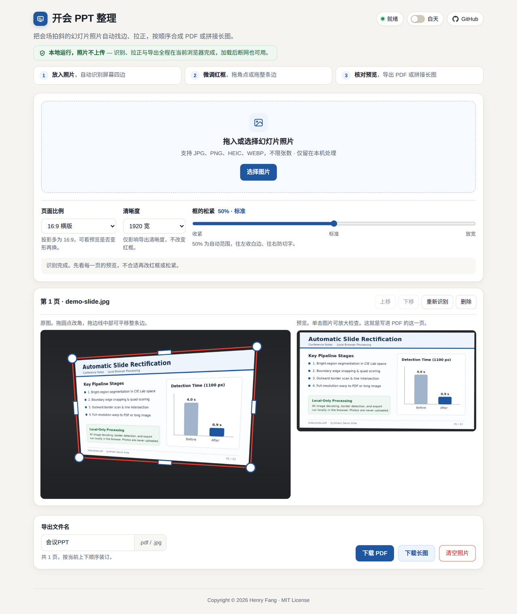

[English](README.md) | **简体中文**

# slide-photo-pdf

把会场里拍斜的幻灯片照片自动找边、拉正，按顺序导出为一份 **PDF** 或**上下拼接长图** —— **全程在本地浏览器运行，照片绝不上传**。

> **在线使用（Demo）：** [https://ideafang.github.io/slide-photo-pdf/](https://ideafang.github.io/slide-photo-pdf/)
>
> **隐私说明：** 照片不会离开你的设备。图像解码、自动找边、透视拉正以及 PDF / 长图生成全部在当前浏览器中完成；页面和识别库加载完成后，断网也能继续使用。



## 解决什么问题

坐在会场座位上拍的投影照片往往是斜的，讲者或讲台也常会挡住屏幕一角。打开页面放入照片，核对或微调红框后，即可一键导出端正清晰的一份 PDF 或拼接长图。

## 主要功能

- **纯本地运行**：基于 OpenCV.js 与 libheif-js 在浏览器端计算，无需安装、无需登录、照片不上传服务器。
- **常见格式全覆盖**：支持 JPEG、PNG、WEBP、BMP 与 HEIC，不设张数硬上限（实际可处理数量取决于设备内存）。
- **精细交互微调**：拖圆点单独调整角点，拖边线中点平移整条边，拖拽时放大镜自动跟随指针；单击预览可查看高清大图。
- **批量排版控制**：统一微调红框松紧（以自动范围为基准约 ±6%），支持 `16:9`、`4:3`、`16:10`、`3:2` 或按检测边长输出，宽度可选 `1280` / `1920` / `2560`。
- **PDF 与长图双导出**：支持合成为单个 **PDF** 或上下拼接的 **JPEG 长图**（移动端超长图自动按画布安全上限缩放）；支持自定义文件名（默认 `会议PPT`）、一键翻转页序（适配手机相册新图在前）以及一键清空照片。
- **白天 / 夜晚模式与状态灯**：右上角可切换明暗主题；状态灯直观显示加载（红）、读图（蓝）、计算（紫蓝）与就绪（绿）。

## 本地运行

可以直接打开上方的 GitHub Pages 在线地址，也可以在本地用 HTTP 提供该目录（请勿直接双击打开 `index.html`，浏览器会拦截本地文件加载 WASM 识别库）。

仅需 Python 3，无需安装任何依赖：

```bash
./serve.sh
```

随后打开 http://127.0.0.1:8766/ 。

```bash
HOST=127.0.0.1 PORT=8766 ./serve.sh
```

- `127.0.0.1` 仅允许本机访问（默认）。
- 设为 `0.0.0.0` 或局域网地址（如 `192.168.1.20`）可让手机等其他设备访问；服务端仅分发静态网页与识别库，照片仍留在各自设备本地处理。

首次打开会加载约 15 MB 的 OpenCV.js 与 HEIC 解码库。

## 幻灯片是怎么找到的

1. 将照片缩小到长边约 1100 像素，在 CIE Lab 亮度通道用多档阈值提取主亮区。
2. 对每个候选区域结合凸包极值、边界 Canny/Hough 直线贴合与长边聚类生成候选四边形。
3. 对去重后的候选框临时拉成灰度 `16:9` 页面，按边缘平滑度、页内线条水平/垂直度与面积综合打分。
4. 在最优框四边由内向外扫描亮暗边界并拟合直线，以相邻直线交点确定四个角，因此即使角被轻微遮挡也能恢复位置。

编辑与预览阶段使用轻量工作图保持流畅，导出 PDF、拼接长图或单击看大图时再按需解码原图做全分辨率透视矫正。

## 仓库结构

| 路径 | 作用 |
|---|---|
| `index.html` | 页面结构、白天/夜晚主题与响应式样式 |
| `app.js` | 照片加载、红框编辑器、放大镜、PDF 生成与长图拼接 |
| `detect.js` | 浏览器端幻灯片找边与透视矫正算法 |
| `vendor/` | 内置 OpenCV.js 与 libheif-js WASM 解码库 |
| `assets/` | 文档界面截图 |
| `serve.sh` | 本地 HTTP 启动脚本 |
| `backup/` | 早先的 Python 服务端版本 |

## 已知限制

- 被讲者或讲台挡住的画面内容无法补全。
- 深色背景幻灯片、屏幕与墙面亮度接近、或页面内有大块纯白卡片时，自动红框可能偏离，手动拖动微调即可。
- 手机浏览器一次处理极大量高分辨率照片时仍受设备内存限制；页数较多时拼接长图会按浏览器画布上限自动等比缩放。
- HEIC 在浏览器中通过 WebAssembly 解码，若个别 HEIC 文件异常，使用 JPEG / PNG / WEBP 更稳妥。

## 第三方库

- `vendor/opencv.js`：OpenCV（Apache-2.0），来自 `@techstark/opencv-js` 5.0.0-release.1。
- `vendor/libheif.js` 与 `vendor/libheif.wasm`：libheif-js 1.19.8（LGPL-3.0）。

## 许可

MIT，见 [LICENSE](LICENSE)。
